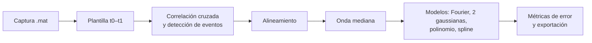

# WaveSynthesis

Herramientas en Python para **caracterizar una forma de onda que se repite** dentro de una captura de osciloscopio y obtener un **modelo compacto** de ella. A partir de un fragmento de referencia (plantilla), el código localiza todas las repeticiones del evento en la señal, las alinea, calcula la onda mediana y la aproxima con varios modelos. El principal es una serie de Fourier truncada cuyos coeficientes se exportan a MATLAB para poder resintetizar la onda.

## Contenido

| Archivo | Para qué sirve |
|---|---|
| `V1.py` | Análisis completo: detección y alineamiento de eventos, onda mediana, ajuste de modelos, métricas de error, gráficas, animaciones y exportación (CSV, JSON, `.mat`). |
| `comparacion_metodos.py` | Compara tres métodos de alineamiento (correlación, máximos locales y centroide) sobre la misma captura para elegir el más adecuado. |

## Requisitos

- Python 3 (probado con Python 3.13).
- Las bibliotecas: `numpy`, `scipy`, `pandas`, `matplotlib`, `tqdm`, `PyWavelets` y `pillow` (para guardar las animaciones GIF).
