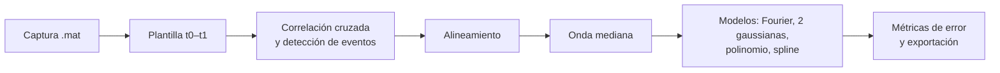

# WaveSynthesis

Herramientas en Python para **caracterizar una forma de onda que se repite** dentro de una captura de osciloscopio y obtener un **modelo compacto** de ella. A partir de un fragmento de referencia (plantilla), el código localiza todas las repeticiones del evento en la señal, las alinea, calcula la onda mediana y la aproxima con varios modelos. El principal es una serie de Fourier truncada cuyos coeficientes se exportan a MATLAB para poder resintetizar la onda.



## Contenido

| Archivo | Para qué sirve |
|---|---|
| `V1.py` | Análisis completo: detección y alineamiento de eventos, onda mediana, ajuste de modelos, métricas de error, gráficas, animaciones y exportación (CSV, JSON, `.mat`). |
| `comparacion_metodos.py` | Compara tres métodos de alineamiento (correlación, máximos locales y centroide) sobre la misma captura para elegir el más adecuado. |

## Requisitos

- Python 3 (probado con Python 3.13).
- Las bibliotecas: `numpy`, `scipy`, `pandas`, `matplotlib`, `tqdm`, `PyWavelets` y `pillow` (para guardar las animaciones GIF).
- `tkinter` para el selector de archivos de `V1.py`. Viene incluido con el instalador oficial de Python en Windows; en Linux, y en algunas instalaciones de macOS, puede hacer falta instalarlo aparte (por ejemplo, el paquete `python3-tk`).

```bash
pip install numpy scipy pandas "matplotlib<3.11" tqdm PyWavelets pillow
```

> **Ojo con matplotlib:** `V1.py` usa `ax.boxplot(labels=...)`, que dejó de existir en matplotlib 3.11. Con esa versión o posteriores el script falla al llegar al boxplot global. Con matplotlib 3.10 funciona de principio a fin.

## Datos de entrada

Ambos scripts leen un archivo `.mat` con, al menos, estas dos variables (el formato de exportación a MATLAB de PicoScope las incluye):

| Variable | Contenido |
|---|---|
| `A` | La señal muestreada (vector). |
| `Tinterval` | Periodo de muestreo en segundos. La frecuencia de muestreo se calcula como `fs = 1 / Tinterval`. |

La señal se usa tal cual, sin normalizar.

## Uso

### `V1.py`: análisis y modelado

```bash
python V1.py
```

1. Se abre un diálogo para elegir el archivo `.mat`.
2. Se define la plantilla (el fragmento de onda que se va a buscar):
   - Si `CONFIG['TEMPLATE_MANUAL']` contiene `(t0, t1)` en segundos, se usa ese intervalo. El valor que trae el script por defecto corresponde a una captura concreta, así que para una señal nueva conviene cambiarlo o ponerlo a `None`.
   - Si vale `None`, aparece la señal completa: haz zoom si lo necesitas, pulsa **Enter** y marca con **dos clics** el inicio y el final del evento.
3. El script continúa solo. Cada figura se muestra en pantalla y la ejecución se detiene hasta que la cierras.

Los resultados se guardan en `resultados/<nombre_del_mat>_resultados_caracterizada/`, relativo a la carpeta desde la que se ejecuta.

### `comparacion_metodos.py`: comparación de alineamientos

1. Indica la ruta de la captura en `CONFIG['FILE_PATH']` (este script no abre diálogo).
2. Ejecuta:

   ```bash
   python comparacion_metodos.py
   ```

3. Con `TEMPLATE_MANUAL = None` la plantilla se selecciona igual que en `V1.py` (zoom, Enter y dos clics).

Los resultados se guardan en `resultados/<nombre_del_mat>_alineamiento_comparativo/`.

## Cómo funciona

### Detección de eventos

Se calcula la correlación cruzada entre la señal completa y la plantilla. Cada pico de esa correlación que supere `CORR_THRESHOLD × máximo de la correlación` se considera un evento. El umbral es, por tanto, una fracción del pico más alto de la correlación cruzada, no un coeficiente de correlación normalizado entre −1 y 1. Alrededor de cada pico se recorta una ventana del mismo tamaño que la plantilla.

### Alineamiento

Cada ventana se desplaza para que coincida con la plantilla. Los métodos disponibles son:

| Método | Criterio | Dónde |
|---|---|---|
| Correlación | Desplazamiento que maximiza la correlación cruzada con la plantilla. | `V1.py` (`'correlation'`) y `comparacion_metodos.py` |
| Pico | Hace coincidir el máximo de \|x\| del segmento con el de la plantilla. | `V1.py` (`'peak'`) |
| Máximos locales | Hace coincidir el pico más alto entre los que superan el 50 % del máximo. | `comparacion_metodos.py` |
| Centroide | Hace coincidir el centroide de \|x\| (centro de “energía”) del segmento con el de la plantilla. | `comparacion_metodos.py` |

Con todos los eventos alineados se calcula la **onda mediana** punto a punto. La mediana se ve menos afectada que la media por eventos atípicos.

### Modelos de la onda mediana (`V1.py`)

| Modelo | Descripción |
|---|---|
| `fourier` | **Fourier dinámico.** Se calcula la FFT real de la onda mediana y se conservan los K primeros coeficientes (la componente continua y los K−1 primeros armónicos). K empieza en `K_INIT` y crece de `K_STEP` en `K_STEP` hasta que el R² de la reconstrucción alcanza `R2_THRESHOLD` (o hasta usar todos los coeficientes). Equivale a un filtro paso bajo con frecuencia de corte (K−1)·fs/N, donde N es el número de muestras del evento. |
| `gausssum` | Suma de dos gaussianas ajustada por mínimos cuadrados (`curve_fit`). Los valores iniciales están pensados para eventos del orden de milisegundos; si el ajuste no converge, el modelo se omite. |
| `poly5` | Polinomio de grado `POLY_DEGREE` (5 por defecto; el nombre se mantiene aunque cambies el grado). |
| `spline` | Spline cúbico interpolante (`UnivariateSpline` con `s = 0`). |

### Métricas de error (`V1.py`)

- **RMSE y R² frente a la onda mediana**, para cada modelo.
- **Distribución del error frente a cada evento individual:** para cada instante se calculan los percentiles 5, 10, 25, 50, 75, 90 y 95 del error absoluto entre el modelo y todos los eventos, junto con los intervalos del 80 % (p90 − p10) y del 90 % (p95 − p5).
- **Percentiles globales** del error absoluto sobre todos los puntos de todos los eventos (p1 a p99, mínimo y máximo).
- **Eventos concatenados:** RMSE y R² entre la concatenación de todos los eventos y el modelo repetido tantas veces como eventos hay.
- **Estadísticas de Fourier:** coeficientes totales y usados y porcentaje de la energía espectral que conservan.

### Métricas de alineamiento (`comparacion_metodos.py`)

- **MSE medio y su desviación típica** entre cada evento alineado y la onda mediana de su método.
- **Coeficiente de variación medio:** desviación típica entre eventos dividida entre el valor absoluto de la media, promediado en el tiempo. Se ignoran los instantes en que la media es prácticamente cero.

Al final, el log indica qué método obtiene el menor MSE y cuál el menor coeficiente de variación.

## Configuración

Los parámetros se editan en el diccionario `CONFIG` al principio de cada script.

### `V1.py`

| Parámetro | Por defecto | Descripción |
|---|---|---|
| `CORR_THRESHOLD` | `0.7` | Umbral de detección, como fracción del máximo de la correlación cruzada. |
| `MIN_DIST_SEC` | `0.05` | Distancia mínima entre eventos en segundos. *No se usa en este script:* la distancia mínima aplicada es la mitad de la longitud de la plantilla. |
| `TEMPLATE_MANUAL` | `(0.19972496, 0.20068723)` | Intervalo `(t0, t1)` de la plantilla en segundos, o `None` para seleccionarla con el ratón. |
| `R2_THRESHOLD` | `0.9999` | R² objetivo para detener el Fourier dinámico. |
| `K_INIT` | `7` | Número inicial de coeficientes de Fourier. |
| `K_STEP` | `3` | Incremento de coeficientes en cada iteración. |
| `ANIMATION_INTERVAL` | `500` | Milisegundos entre fotogramas de las animaciones. |
| `GENERATE_ANIMATIONS` | `True` | Generar o no los GIF. |
| `SAVE_PLOTS` | `True` | Si es `False`, algunas figuras solo se muestran y no se guardan. |
| `USE_PARALLEL` | `True` | Alinear los eventos en paralelo con varios procesos. |
| `N_WORKERS` | `4` | Número de procesos para el alineamiento en paralelo. |
| `GAUSS_MAXFEV` | `2000` | Evaluaciones máximas del ajuste de gaussianas. |
| `POLY_DEGREE` | `5` | Grado del polinomio. |
| `ALIGN_METHOD` | `'correlation'` | `'correlation'` o `'peak'`. |

### `comparacion_metodos.py`

| Parámetro | Por defecto | Descripción |
|---|---|---|
| `CORR_THRESHOLD` | `0.6` | Umbral de detección, como fracción del máximo de la correlación cruzada. |
| `MIN_DIST_SEC` | `0.05` | Distancia mínima entre eventos detectados, en segundos. |
| `TEMPLATE_MANUAL` | `None` | Intervalo `(t0, t1)` de la plantilla, o `None` para seleccionarla con el ratón. |
| `ALIGNMENT_METHOD` | `'Correlación'` | Solo se registra en el log; el script siempre compara los tres métodos. |
| `SAVE_PLOTS` | `True` | Sin efecto en este script: todas las figuras se guardan siempre. |
| `FILE_PATH` | `'ondas/PV-N18APEXAN-AUTSINC.mat'` | Ruta de la captura. La carpeta `ondas/` no está en el repositorio; apunta a tu propio archivo. |

## Resultados

Todos los nombres empiezan por el nombre del archivo `.mat` analizado (`<mat>`).

### `V1.py`

| Archivo | Contenido |
|---|---|
| `<mat>_Fragmento_seleccionado.png` | Plantilla seleccionada. |
| `<mat>_eventos_alineados.png` | Todos los eventos alineados con la onda mediana superpuesta. |
| `<mat>_stack.csv` | Eventos alineados (una columna por evento) y la mediana. |
| `<mat>_fourier_coeffs.csv` | Todos los coeficientes de la FFT: parte real, imaginaria, módulo y fase. |
| `<mat>_r2_vs_K.csv` | R² obtenido en cada iteración del Fourier dinámico. |
| `<mat>_animacion_fourier.gif`, `<mat>_animacion_r2.gif` | Evolución de la reconstrucción y del R² al aumentar K. |
| `<mat>_aproximaciones.png`, `<mat>_reconstruccion_fourier.png` | Modelos frente a la onda mediana. |
| `<mat>_reconstructions.csv` | Onda reconstruida por cada modelo. |
| `<mat>_fourier_trunc_<K>.mat` | Coeficientes truncados para MATLAB (ver más abajo). |
| `<mat>_fourier_coefs_usados.png`, `<mat>_fourier_coefs_fase.png` | Módulo y fase de los coeficientes, distinguiendo los usados. |
| `<mat>_errores_mediana.png` | Error de cada modelo frente a la mediana. |
| `<mat>_percentiles_eventos_<modelo>.csv` | Percentiles del error por instante, para cada modelo. |
| `<mat>_boxplot_eventos_<modelo>.png` | Bandas de percentiles del error a lo largo del evento. |
| `<mat>_boxplot_global_errores.png` | Boxplot del error absoluto de cada modelo sobre todos los eventos. |
| `<mat>_rmse_concatenado.png`, `<mat>_r2_concatenado.png`, `<mat>_metricas_concatenadas.csv` | Métricas sobre los eventos concatenados. |
| `<mat>_analisis.log` | Resumen legible de todo el análisis. |
| `<mat>_metricas.json` | Las mismas métricas en formato JSON. |
| `analysis_config.json` | Configuración usada, con hora de inicio y de fin. |

### `comparacion_metodos.py`

| Archivo | Contenido |
|---|---|
| `<mat>_Fragmento_seleccionado.png` | Plantilla seleccionada. |
| `<mat>_eventos_alineados_<método>.png` | Eventos alineados y mediana con cada método. |
| `<mat>_comparacion_medianas.png`, `<mat>_comparacion_dispersion.png` | Medianas y desviación típica de los tres métodos superpuestas. |
| `<mat>_ejemplo_comparativo.png` | Un mismo evento alineado con cada método. |
| `<mat>_metricas_comparativas.png`, `<mat>_metricas_alineamiento.csv` | MSE y coeficiente de variación de cada método. |
| `<mat>_stack_<método>.csv` | Eventos alineados y mediana de cada método. |
| `<mat>_analisis_log.txt` | Log con marcas de tiempo, incluidos los instantes de cada evento detectado. |
| `analysis_config.json` | Configuración usada. |

## Usar el modelo de Fourier en MATLAB

`<mat>_fourier_trunc_<K>.mat` contiene:

| Variable | Contenido |
|---|---|
| `Y_trunc` | Medio espectro de la FFT real de NumPy (`N/2 + 1` valores complejos si N es par, `(N + 1)/2` si es impar), con todo a cero salvo los K primeros coeficientes. |
| `N` | Número de muestras del evento. |
| `m_rec_fourier` | La onda ya reconstruida a partir de esos coeficientes. |
| `Freq_Original` | Frecuencia de muestreo original, en Hz. |

Si solo necesitas la forma de onda, usa `m_rec_fourier` directamente. Para reconstruirla a partir de los coeficientes hay que completar el espectro con su parte conjugada simétrica, porque `ifft` de MATLAB espera el espectro entero:

```matlab
S  = load('<mat>_fourier_trunc_<K>.mat');
Y  = S.Y_trunc(:);
N  = double(S.N);
fs = S.Freq_Original;

if mod(N, 2) == 0
    Yfull = [Y; conj(Y(end-1:-1:2))];
else
    Yfull = [Y; conj(Y(end:-1:2))];
end

x = real(ifft(Yfull));
t = (0:N-1).' / fs;
plot(t, x)
```

En Python basta con `np.fft.irfft(Y_trunc.ravel(), n=N)`.

## Notas y limitaciones

- **Ejecución interactiva.** Todas las figuras se abren con `plt.show()` y el script espera a que las cierres. Para ejecutarlo sin ventanas, fija la plantilla en `TEMPLATE_MANUAL`, define la variable de entorno `MPLBACKEND=Agg` y, en `V1.py`, sustituye el diálogo de `cargar_datos_mat()` por una ruta fija.
- **El spline interpola la mediana.** Con `s = 0` pasa exactamente por todos sus puntos, así que su error frente a la mediana es cero por construcción. Sirve como referencia, pero no es una aproximación compacta comparable a la de Fourier.
- **Desplazamiento circular.** El alineamiento usa `np.roll`, de modo que las muestras que salen por un extremo de la ventana entran por el otro. Con desplazamientos pequeños el efecto es despreciable.
- **Coeficiente de variación.** Cerca de los cruces por cero la media es pequeña y el cociente crece mucho, lo que puede dominar el promedio.

## Autor

Mikel Muñoz Vega
