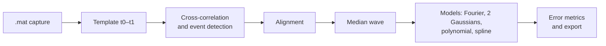
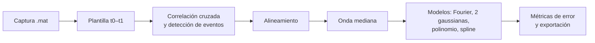

# WaveSynthesis

**[English](#english) · [Español](#español)**

## English

Python tools to **characterise a waveform that repeats** inside an oscilloscope capture and build a **compact model** of it. Starting from a reference fragment (the template), the code finds every repetition of the event in the signal, aligns them, computes the median wave and approximates it with several models. The main one is a truncated Fourier series whose coefficients are exported to MATLAB so the wave can be resynthesised.



### Contents

| File | Purpose |
|---|---|
| `V1.py` | Full analysis: event detection and alignment, median wave, model fitting, error metrics, plots, animations and export (CSV, JSON, `.mat`). |
| `comparacion_metodos.py` | Compares three alignment methods (correlation, local maxima and centroid) on the same capture to choose the most suitable one. |

### Requirements

- Python 3 (tested with Python 3.13).
- The libraries `numpy`, `scipy`, `pandas`, `matplotlib`, `tqdm`, `PyWavelets` and `pillow` (to save the GIF animations).
- `tkinter` for the file picker in `V1.py`. It ships with the official Python installer on Windows; on Linux, and on some macOS installations, it may need to be installed separately (for example, the `python3-tk` package).

```bash
pip install numpy scipy pandas "matplotlib<3.11" tqdm PyWavelets pillow
```

> **Watch out for matplotlib:** `V1.py` uses `ax.boxplot(labels=...)`, which no longer exists in matplotlib 3.11. With that version or later the script fails when it reaches the global boxplot. With matplotlib 3.10 it runs from start to finish.

### Input data

Both scripts read a `.mat` file with at least these two variables (PicoScope's MATLAB export format includes them):

| Variable | Content |
|---|---|
| `A` | The sampled signal (vector). |
| `Tinterval` | Sampling period in seconds. The sampling frequency is computed as `fs = 1 / Tinterval`. |

The signal is used as is, without normalisation.

### Usage

#### `V1.py`: analysis and modelling

```bash
python V1.py
```

1. A dialog opens to choose the `.mat` file.
2. The template (the wave fragment to search for) is defined:
   - If `CONFIG['TEMPLATE_MANUAL']` holds `(t0, t1)` in seconds, that interval is used. The default value in the script belongs to a specific capture, so for a new signal you should change it or set it to `None`.
   - If it is `None`, the whole signal is shown: zoom in if you need to, press **Enter** and mark the start and end of the event with **two clicks**.
3. The script carries on by itself. Each figure is shown on screen and execution pauses until you close it.

Results are saved in `resultados/<mat_name>_resultados_caracterizada/`, relative to the folder the script is run from.

#### `comparacion_metodos.py`: alignment comparison

1. Set the path of the capture in `CONFIG['FILE_PATH']` (this script does not open a dialog).
2. Run:

   ```bash
   python comparacion_metodos.py
   ```

3. With `TEMPLATE_MANUAL = None` the template is selected the same way as in `V1.py` (zoom, Enter and two clicks).

Results are saved in `resultados/<mat_name>_alineamiento_comparativo/`.

### How it works

#### Event detection

The cross-correlation between the whole signal and the template is computed. Every peak of that correlation above `CORR_THRESHOLD × maximum of the correlation` is treated as an event. The threshold is therefore a fraction of the highest cross-correlation peak, not a normalised correlation coefficient between −1 and 1. A window the same size as the template is cut out around each peak.

#### Alignment

Each window is shifted to match the template. The available methods are:

| Method | Criterion | Where |
|---|---|---|
| Correlation | Shift that maximises the cross-correlation with the template. | `V1.py` (`'correlation'`) and `comparacion_metodos.py` |
| Peak | Matches the maximum of \|x\| in the segment with that of the template. | `V1.py` (`'peak'`) |
| Local maxima | Matches the highest peak among those above 50 % of the maximum. | `comparacion_metodos.py` |
| Centroid | Matches the centroid of \|x\| (the “energy” centre) of the segment with that of the template. | `comparacion_metodos.py` |

Once all events are aligned, the **median wave** is computed point by point. The median is less affected than the mean by outlier events.

#### Models of the median wave (`V1.py`)

| Model | Description |
|---|---|
| `fourier` | **Dynamic Fourier.** The real FFT of the median wave is computed and the first K coefficients are kept (the DC component and the first K−1 harmonics). K starts at `K_INIT` and grows in steps of `K_STEP` until the R² of the reconstruction reaches `R2_THRESHOLD` (or all coefficients are used). It is equivalent to a low-pass filter with cut-off frequency (K−1)·fs/N, where N is the number of samples in the event. |
| `gausssum` | Sum of two Gaussians fitted by least squares (`curve_fit`). The initial values are meant for events on the millisecond scale; if the fit does not converge, the model is skipped. |
| `poly5` | Polynomial of degree `POLY_DEGREE` (5 by default; the name stays the same if you change the degree). |
| `spline` | Interpolating cubic spline (`UnivariateSpline` with `s = 0`). |

#### Error metrics (`V1.py`)

- **RMSE and R² against the median wave**, for each model.
- **Error distribution against each individual event:** for every time instant, the 5th, 10th, 25th, 50th, 75th, 90th and 95th percentiles of the absolute error between the model and all events, together with the 80 % (p90 − p10) and 90 % (p95 − p5) intervals.
- **Global percentiles** of the absolute error over every point of every event (p1 to p99, minimum and maximum).
- **Concatenated events:** RMSE and R² between the concatenation of all events and the model repeated once per event.
- **Fourier statistics:** total and used coefficients and the percentage of spectral energy they keep.

#### Alignment metrics (`comparacion_metodos.py`)

- **Mean MSE and its standard deviation** between each aligned event and the median wave of its method.
- **Mean coefficient of variation:** standard deviation across events divided by the absolute value of the mean, averaged over time. Instants where the mean is practically zero are ignored.

At the end, the log reports which method gets the lowest MSE and which the lowest coefficient of variation.

### Configuration

Parameters are edited in the `CONFIG` dictionary at the top of each script.

#### `V1.py`

| Parameter | Default | Description |
|---|---|---|
| `CORR_THRESHOLD` | `0.7` | Detection threshold, as a fraction of the maximum of the cross-correlation. |
| `MIN_DIST_SEC` | `0.05` | Minimum distance between events in seconds. *Not used in this script:* the minimum distance actually applied is half the template length. |
| `TEMPLATE_MANUAL` | `(0.19972496, 0.20068723)` | Template interval `(t0, t1)` in seconds, or `None` to select it with the mouse. |
| `R2_THRESHOLD` | `0.9999` | Target R² to stop the dynamic Fourier. |
| `K_INIT` | `7` | Initial number of Fourier coefficients. |
| `K_STEP` | `3` | Coefficient increment at each iteration. |
| `ANIMATION_INTERVAL` | `500` | Milliseconds between animation frames. |
| `GENERATE_ANIMATIONS` | `True` | Whether to generate the GIFs. |
| `SAVE_PLOTS` | `True` | If `False`, some figures are only shown and not saved. |
| `USE_PARALLEL` | `True` | Align events in parallel using several processes. |
| `N_WORKERS` | `4` | Number of processes for parallel alignment. |
| `GAUSS_MAXFEV` | `2000` | Maximum evaluations for the Gaussian fit. |
| `POLY_DEGREE` | `5` | Degree of the polynomial. |
| `ALIGN_METHOD` | `'correlation'` | `'correlation'` or `'peak'`. |

#### `comparacion_metodos.py`

| Parameter | Default | Description |
|---|---|---|
| `CORR_THRESHOLD` | `0.6` | Detection threshold, as a fraction of the maximum of the cross-correlation. |
| `MIN_DIST_SEC` | `0.05` | Minimum distance between detected events, in seconds. |
| `TEMPLATE_MANUAL` | `None` | Template interval `(t0, t1)`, or `None` to select it with the mouse. |
| `ALIGNMENT_METHOD` | `'Correlación'` | Only written to the log; the script always compares the three methods. |
| `SAVE_PLOTS` | `True` | No effect in this script: every figure is always saved. |
| `FILE_PATH` | `'ondas/PV-N18APEXAN-AUTSINC.mat'` | Path of the capture. The `ondas/` folder is not in the repository; point it to your own file. |

### Output

All names start with the name of the analysed `.mat` file (`<mat>`).

#### `V1.py`

| File | Content |
|---|---|
| `<mat>_Fragmento_seleccionado.png` | Selected template. |
| `<mat>_eventos_alineados.png` | All aligned events with the median wave on top. |
| `<mat>_stack.csv` | Aligned events (one column per event) and the median. |
| `<mat>_fourier_coeffs.csv` | All FFT coefficients: real part, imaginary part, magnitude and phase. |
| `<mat>_r2_vs_K.csv` | R² obtained at each iteration of the dynamic Fourier. |
| `<mat>_animacion_fourier.gif`, `<mat>_animacion_r2.gif` | How the reconstruction and R² evolve as K grows. |
| `<mat>_aproximaciones.png`, `<mat>_reconstruccion_fourier.png` | Models against the median wave. |
| `<mat>_reconstructions.csv` | Wave reconstructed by each model. |
| `<mat>_fourier_trunc_<K>.mat` | Truncated coefficients for MATLAB (see below). |
| `<mat>_fourier_coefs_usados.png`, `<mat>_fourier_coefs_fase.png` | Magnitude and phase of the coefficients, highlighting the ones used. |
| `<mat>_errores_mediana.png` | Error of each model against the median. |
| `<mat>_percentiles_eventos_<model>.csv` | Error percentiles per time instant, for each model. |
| `<mat>_boxplot_eventos_<model>.png` | Error percentile bands along the event. |
| `<mat>_boxplot_global_errores.png` | Boxplot of the absolute error of each model over all events. |
| `<mat>_rmse_concatenado.png`, `<mat>_r2_concatenado.png`, `<mat>_metricas_concatenadas.csv` | Metrics on the concatenated events. |
| `<mat>_analisis.log` | Readable summary of the whole analysis. |
| `<mat>_metricas.json` | The same metrics in JSON format. |
| `analysis_config.json` | Configuration used, with start and end times. |

#### `comparacion_metodos.py`

| File | Content |
|---|---|
| `<mat>_Fragmento_seleccionado.png` | Selected template. |
| `<mat>_eventos_alineados_<method>.png` | Aligned events and median for each method. |
| `<mat>_comparacion_medianas.png`, `<mat>_comparacion_dispersion.png` | Medians and standard deviation of the three methods overlaid. |
| `<mat>_ejemplo_comparativo.png` | The same event aligned with each method. |
| `<mat>_metricas_comparativas.png`, `<mat>_metricas_alineamiento.csv` | MSE and coefficient of variation of each method. |
| `<mat>_stack_<method>.csv` | Aligned events and median for each method. |
| `<mat>_analisis_log.txt` | Timestamped log, including the time of each detected event. |
| `analysis_config.json` | Configuration used. |

### Using the Fourier model in MATLAB

`<mat>_fourier_trunc_<K>.mat` contains:

| Variable | Content |
|---|---|
| `Y_trunc` | Half spectrum of NumPy's real FFT (`N/2 + 1` complex values if N is even, `(N + 1)/2` if it is odd), all zero except the first K coefficients. |
| `N` | Number of samples in the event. |
| `m_rec_fourier` | The wave already reconstructed from those coefficients. |
| `Freq_Original` | Original sampling frequency, in Hz. |

If you only need the waveform, use `m_rec_fourier` directly. To rebuild it from the coefficients, the spectrum has to be completed with its conjugate-symmetric half, because MATLAB's `ifft` expects the full spectrum:

```matlab
S  = load('<mat>_fourier_trunc_<K>.mat');
Y  = S.Y_trunc(:);
N  = double(S.N);
fs = S.Freq_Original;

if mod(N, 2) == 0
    Yfull = [Y; conj(Y(end-1:-1:2))];
else
    Yfull = [Y; conj(Y(end:-1:2))];
end

x = real(ifft(Yfull));
t = (0:N-1).' / fs;
plot(t, x)
```

In Python, `np.fft.irfft(Y_trunc.ravel(), n=N)` is enough.

### Notes and limitations

- **Interactive execution.** Every figure opens with `plt.show()` and the script waits until you close it. To run it without windows, fix the template in `TEMPLATE_MANUAL`, set the environment variable `MPLBACKEND=Agg` and, in `V1.py`, replace the `cargar_datos_mat()` dialog with a fixed path.
- **The spline interpolates the median.** With `s = 0` it passes exactly through every point, so its error against the median is zero by construction. It is useful as a reference, but it is not a compact approximation comparable to the Fourier one.
- **Circular shift.** Alignment uses `np.roll`, so samples that leave one end of the window come back in at the other. With small shifts the effect is negligible.
- **Coefficient of variation.** Near zero crossings the mean is small and the ratio grows a lot, which can dominate the average.

### Author

Mikel Muñoz Vega

---

## Español

Herramientas en Python para **caracterizar una forma de onda que se repite** dentro de una captura de osciloscopio y obtener un **modelo compacto** de ella. A partir de un fragmento de referencia (plantilla), el código localiza todas las repeticiones del evento en la señal, las alinea, calcula la onda mediana y la aproxima con varios modelos. El principal es una serie de Fourier truncada cuyos coeficientes se exportan a MATLAB para poder resintetizar la onda.



### Contenido

| Archivo | Para qué sirve |
|---|---|
| `V1.py` | Análisis completo: detección y alineamiento de eventos, onda mediana, ajuste de modelos, métricas de error, gráficas, animaciones y exportación (CSV, JSON, `.mat`). |
| `comparacion_metodos.py` | Compara tres métodos de alineamiento (correlación, máximos locales y centroide) sobre la misma captura para elegir el más adecuado. |

### Requisitos

- Python 3 (probado con Python 3.13).
- Las bibliotecas: `numpy`, `scipy`, `pandas`, `matplotlib`, `tqdm`, `PyWavelets` y `pillow` (para guardar las animaciones GIF).
- `tkinter` para el selector de archivos de `V1.py`. Viene incluido con el instalador oficial de Python en Windows; en Linux, y en algunas instalaciones de macOS, puede hacer falta instalarlo aparte (por ejemplo, el paquete `python3-tk`).

```bash
pip install numpy scipy pandas "matplotlib<3.11" tqdm PyWavelets pillow
```

> **Ojo con matplotlib:** `V1.py` usa `ax.boxplot(labels=...)`, que dejó de existir en matplotlib 3.11. Con esa versión o posteriores el script falla al llegar al boxplot global. Con matplotlib 3.10 funciona de principio a fin.

### Datos de entrada

Ambos scripts leen un archivo `.mat` con, al menos, estas dos variables (el formato de exportación a MATLAB de PicoScope las incluye):

| Variable | Contenido |
|---|---|
| `A` | La señal muestreada (vector). |
| `Tinterval` | Periodo de muestreo en segundos. La frecuencia de muestreo se calcula como `fs = 1 / Tinterval`. |

La señal se usa tal cual, sin normalizar.

### Uso

#### `V1.py`: análisis y modelado

```bash
python V1.py
```

1. Se abre un diálogo para elegir el archivo `.mat`.
2. Se define la plantilla (el fragmento de onda que se va a buscar):
   - Si `CONFIG['TEMPLATE_MANUAL']` contiene `(t0, t1)` en segundos, se usa ese intervalo. El valor que trae el script por defecto corresponde a una captura concreta, así que para una señal nueva conviene cambiarlo o ponerlo a `None`.
   - Si vale `None`, aparece la señal completa: haz zoom si lo necesitas, pulsa **Enter** y marca con **dos clics** el inicio y el final del evento.
3. El script continúa solo. Cada figura se muestra en pantalla y la ejecución se detiene hasta que la cierras.

Los resultados se guardan en `resultados/<nombre_del_mat>_resultados_caracterizada/`, relativo a la carpeta desde la que se ejecuta.

#### `comparacion_metodos.py`: comparación de alineamientos

1. Indica la ruta de la captura en `CONFIG['FILE_PATH']` (este script no abre diálogo).
2. Ejecuta:

   ```bash
   python comparacion_metodos.py
   ```

3. Con `TEMPLATE_MANUAL = None` la plantilla se selecciona igual que en `V1.py` (zoom, Enter y dos clics).

Los resultados se guardan en `resultados/<nombre_del_mat>_alineamiento_comparativo/`.

### Cómo funciona

#### Detección de eventos

Se calcula la correlación cruzada entre la señal completa y la plantilla. Cada pico de esa correlación que supere `CORR_THRESHOLD × máximo de la correlación` se considera un evento. El umbral es, por tanto, una fracción del pico más alto de la correlación cruzada, no un coeficiente de correlación normalizado entre −1 y 1. Alrededor de cada pico se recorta una ventana del mismo tamaño que la plantilla.

#### Alineamiento

Cada ventana se desplaza para que coincida con la plantilla. Los métodos disponibles son:

| Método | Criterio | Dónde |
|---|---|---|
| Correlación | Desplazamiento que maximiza la correlación cruzada con la plantilla. | `V1.py` (`'correlation'`) y `comparacion_metodos.py` |
| Pico | Hace coincidir el máximo de \|x\| del segmento con el de la plantilla. | `V1.py` (`'peak'`) |
| Máximos locales | Hace coincidir el pico más alto entre los que superan el 50 % del máximo. | `comparacion_metodos.py` |
| Centroide | Hace coincidir el centroide de \|x\| (centro de “energía”) del segmento con el de la plantilla. | `comparacion_metodos.py` |

Con todos los eventos alineados se calcula la **onda mediana** punto a punto. La mediana se ve menos afectada que la media por eventos atípicos.

#### Modelos de la onda mediana (`V1.py`)

| Modelo | Descripción |
|---|---|
| `fourier` | **Fourier dinámico.** Se calcula la FFT real de la onda mediana y se conservan los K primeros coeficientes (la componente continua y los K−1 primeros armónicos). K empieza en `K_INIT` y crece de `K_STEP` en `K_STEP` hasta que el R² de la reconstrucción alcanza `R2_THRESHOLD` (o hasta usar todos los coeficientes). Equivale a un filtro paso bajo con frecuencia de corte (K−1)·fs/N, donde N es el número de muestras del evento. |
| `gausssum` | Suma de dos gaussianas ajustada por mínimos cuadrados (`curve_fit`). Los valores iniciales están pensados para eventos del orden de milisegundos; si el ajuste no converge, el modelo se omite. |
| `poly5` | Polinomio de grado `POLY_DEGREE` (5 por defecto; el nombre se mantiene aunque cambies el grado). |
| `spline` | Spline cúbico interpolante (`UnivariateSpline` con `s = 0`). |

#### Métricas de error (`V1.py`)

- **RMSE y R² frente a la onda mediana**, para cada modelo.
- **Distribución del error frente a cada evento individual:** para cada instante se calculan los percentiles 5, 10, 25, 50, 75, 90 y 95 del error absoluto entre el modelo y todos los eventos, junto con los intervalos del 80 % (p90 − p10) y del 90 % (p95 − p5).
- **Percentiles globales** del error absoluto sobre todos los puntos de todos los eventos (p1 a p99, mínimo y máximo).
- **Eventos concatenados:** RMSE y R² entre la concatenación de todos los eventos y el modelo repetido tantas veces como eventos hay.
- **Estadísticas de Fourier:** coeficientes totales y usados y porcentaje de la energía espectral que conservan.

#### Métricas de alineamiento (`comparacion_metodos.py`)

- **MSE medio y su desviación típica** entre cada evento alineado y la onda mediana de su método.
- **Coeficiente de variación medio:** desviación típica entre eventos dividida entre el valor absoluto de la media, promediado en el tiempo. Se ignoran los instantes en que la media es prácticamente cero.

Al final, el log indica qué método obtiene el menor MSE y cuál el menor coeficiente de variación.

### Configuración

Los parámetros se editan en el diccionario `CONFIG` al principio de cada script.

#### `V1.py`

| Parámetro | Por defecto | Descripción |
|---|---|---|
| `CORR_THRESHOLD` | `0.7` | Umbral de detección, como fracción del máximo de la correlación cruzada. |
| `MIN_DIST_SEC` | `0.05` | Distancia mínima entre eventos en segundos. *No se usa en este script:* la distancia mínima aplicada es la mitad de la longitud de la plantilla. |
| `TEMPLATE_MANUAL` | `(0.19972496, 0.20068723)` | Intervalo `(t0, t1)` de la plantilla en segundos, o `None` para seleccionarla con el ratón. |
| `R2_THRESHOLD` | `0.9999` | R² objetivo para detener el Fourier dinámico. |
| `K_INIT` | `7` | Número inicial de coeficientes de Fourier. |
| `K_STEP` | `3` | Incremento de coeficientes en cada iteración. |
| `ANIMATION_INTERVAL` | `500` | Milisegundos entre fotogramas de las animaciones. |
| `GENERATE_ANIMATIONS` | `True` | Generar o no los GIF. |
| `SAVE_PLOTS` | `True` | Si es `False`, algunas figuras solo se muestran y no se guardan. |
| `USE_PARALLEL` | `True` | Alinear los eventos en paralelo con varios procesos. |
| `N_WORKERS` | `4` | Número de procesos para el alineamiento en paralelo. |
| `GAUSS_MAXFEV` | `2000` | Evaluaciones máximas del ajuste de gaussianas. |
| `POLY_DEGREE` | `5` | Grado del polinomio. |
| `ALIGN_METHOD` | `'correlation'` | `'correlation'` o `'peak'`. |

#### `comparacion_metodos.py`

| Parámetro | Por defecto | Descripción |
|---|---|---|
| `CORR_THRESHOLD` | `0.6` | Umbral de detección, como fracción del máximo de la correlación cruzada. |
| `MIN_DIST_SEC` | `0.05` | Distancia mínima entre eventos detectados, en segundos. |
| `TEMPLATE_MANUAL` | `None` | Intervalo `(t0, t1)` de la plantilla, o `None` para seleccionarla con el ratón. |
| `ALIGNMENT_METHOD` | `'Correlación'` | Solo se registra en el log; el script siempre compara los tres métodos. |
| `SAVE_PLOTS` | `True` | Sin efecto en este script: todas las figuras se guardan siempre. |
| `FILE_PATH` | `'ondas/PV-N18APEXAN-AUTSINC.mat'` | Ruta de la captura. La carpeta `ondas/` no está en el repositorio; apunta a tu propio archivo. |

### Resultados

Todos los nombres empiezan por el nombre del archivo `.mat` analizado (`<mat>`).

#### `V1.py`

| Archivo | Contenido |
|---|---|
| `<mat>_Fragmento_seleccionado.png` | Plantilla seleccionada. |
| `<mat>_eventos_alineados.png` | Todos los eventos alineados con la onda mediana superpuesta. |
| `<mat>_stack.csv` | Eventos alineados (una columna por evento) y la mediana. |
| `<mat>_fourier_coeffs.csv` | Todos los coeficientes de la FFT: parte real, imaginaria, módulo y fase. |
| `<mat>_r2_vs_K.csv` | R² obtenido en cada iteración del Fourier dinámico. |
| `<mat>_animacion_fourier.gif`, `<mat>_animacion_r2.gif` | Evolución de la reconstrucción y del R² al aumentar K. |
| `<mat>_aproximaciones.png`, `<mat>_reconstruccion_fourier.png` | Modelos frente a la onda mediana. |
| `<mat>_reconstructions.csv` | Onda reconstruida por cada modelo. |
| `<mat>_fourier_trunc_<K>.mat` | Coeficientes truncados para MATLAB (ver más abajo). |
| `<mat>_fourier_coefs_usados.png`, `<mat>_fourier_coefs_fase.png` | Módulo y fase de los coeficientes, distinguiendo los usados. |
| `<mat>_errores_mediana.png` | Error de cada modelo frente a la mediana. |
| `<mat>_percentiles_eventos_<modelo>.csv` | Percentiles del error por instante, para cada modelo. |
| `<mat>_boxplot_eventos_<modelo>.png` | Bandas de percentiles del error a lo largo del evento. |
| `<mat>_boxplot_global_errores.png` | Boxplot del error absoluto de cada modelo sobre todos los eventos. |
| `<mat>_rmse_concatenado.png`, `<mat>_r2_concatenado.png`, `<mat>_metricas_concatenadas.csv` | Métricas sobre los eventos concatenados. |
| `<mat>_analisis.log` | Resumen legible de todo el análisis. |
| `<mat>_metricas.json` | Las mismas métricas en formato JSON. |
| `analysis_config.json` | Configuración usada, con hora de inicio y de fin. |

#### `comparacion_metodos.py`

| Archivo | Contenido |
|---|---|
| `<mat>_Fragmento_seleccionado.png` | Plantilla seleccionada. |
| `<mat>_eventos_alineados_<método>.png` | Eventos alineados y mediana con cada método. |
| `<mat>_comparacion_medianas.png`, `<mat>_comparacion_dispersion.png` | Medianas y desviación típica de los tres métodos superpuestas. |
| `<mat>_ejemplo_comparativo.png` | Un mismo evento alineado con cada método. |
| `<mat>_metricas_comparativas.png`, `<mat>_metricas_alineamiento.csv` | MSE y coeficiente de variación de cada método. |
| `<mat>_stack_<método>.csv` | Eventos alineados y mediana de cada método. |
| `<mat>_analisis_log.txt` | Log con marcas de tiempo, incluidos los instantes de cada evento detectado. |
| `analysis_config.json` | Configuración usada. |

### Usar el modelo de Fourier en MATLAB

`<mat>_fourier_trunc_<K>.mat` contiene:

| Variable | Contenido |
|---|---|
| `Y_trunc` | Medio espectro de la FFT real de NumPy (`N/2 + 1` valores complejos si N es par, `(N + 1)/2` si es impar), con todo a cero salvo los K primeros coeficientes. |
| `N` | Número de muestras del evento. |
| `m_rec_fourier` | La onda ya reconstruida a partir de esos coeficientes. |
| `Freq_Original` | Frecuencia de muestreo original, en Hz. |

Si solo necesitas la forma de onda, usa `m_rec_fourier` directamente. Para reconstruirla a partir de los coeficientes hay que completar el espectro con su parte conjugada simétrica, porque `ifft` de MATLAB espera el espectro entero:

```matlab
S  = load('<mat>_fourier_trunc_<K>.mat');
Y  = S.Y_trunc(:);
N  = double(S.N);
fs = S.Freq_Original;

if mod(N, 2) == 0
    Yfull = [Y; conj(Y(end-1:-1:2))];
else
    Yfull = [Y; conj(Y(end:-1:2))];
end

x = real(ifft(Yfull));
t = (0:N-1).' / fs;
plot(t, x)
```

En Python basta con `np.fft.irfft(Y_trunc.ravel(), n=N)`.

### Notas y limitaciones

- **Ejecución interactiva.** Todas las figuras se abren con `plt.show()` y el script espera a que las cierres. Para ejecutarlo sin ventanas, fija la plantilla en `TEMPLATE_MANUAL`, define la variable de entorno `MPLBACKEND=Agg` y, en `V1.py`, sustituye el diálogo de `cargar_datos_mat()` por una ruta fija.
- **El spline interpola la mediana.** Con `s = 0` pasa exactamente por todos sus puntos, así que su error frente a la mediana es cero por construcción. Sirve como referencia, pero no es una aproximación compacta comparable a la de Fourier.
- **Desplazamiento circular.** El alineamiento usa `np.roll`, de modo que las muestras que salen por un extremo de la ventana entran por el otro. Con desplazamientos pequeños el efecto es despreciable.
- **Coeficiente de variación.** Cerca de los cruces por cero la media es pequeña y el cociente crece mucho, lo que puede dominar el promedio.

### Autor

Mikel Muñoz Vega
